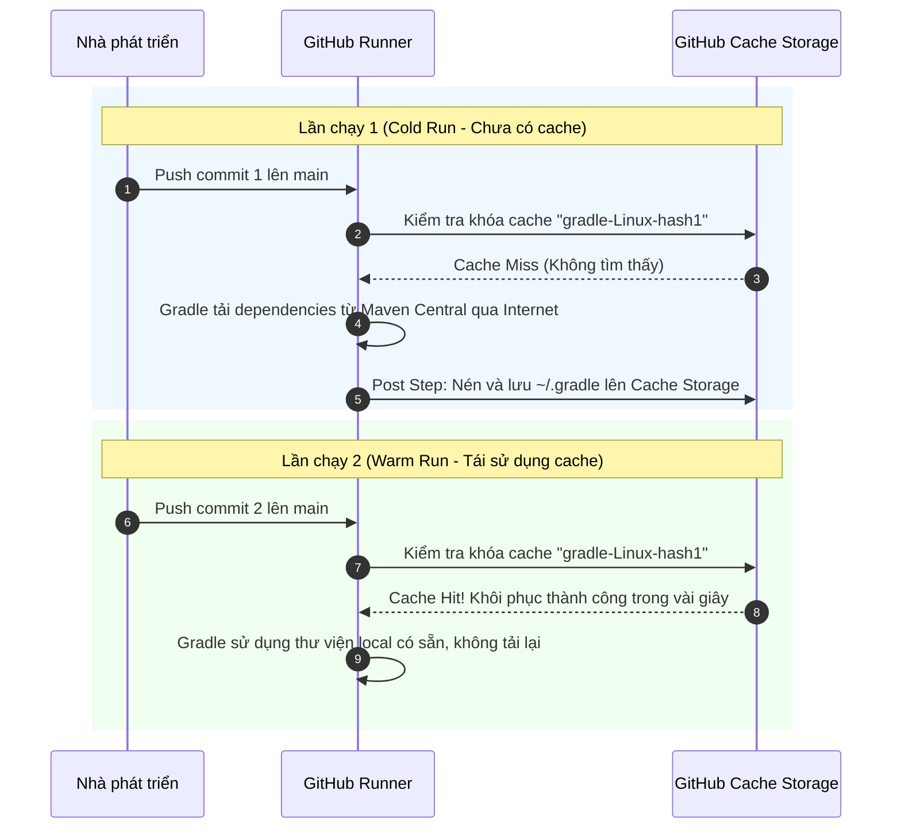

# Báo cáo Kỹ thuật: Tối ưu tốc độ CI bằng Gradle Dependency Caching

## 1. Mục tiêu bài thực hành
- Áp dụng kỹ thuật Caching trong CI/CD pipeline để giải quyết nút thắt cổ chai về thời gian tải thư viện phụ thuộc (dependencies) từ Internet.
- Khảo sát và đánh giá cơ chế tự động quản lý Cache của `actions/setup-java@v5` với tùy chọn `cache: 'gradle'`.
- Thực hiện kiểm chứng thực nghiệm bằng việc đẩy code 2 lần liên tiếp, phân tích sự thay đổi trong nhật ký log và đo lường thời gian thực thi giữa lần đầu (Cold Run - Chưa có Cache) và lần sau (Warm Run - Đã khôi phục Cache).

---

## 2. Kịch bản GitHub Actions Workflow (`.github/workflows/ci.yml`)

```yaml
name: Java Spring Boot CI (Gradle)

on:
  push:
    branches: [ "main" ]

jobs:
  test:
    name: Run Unit Tests
    runs-on: ubuntu-latest

    steps:
      - name: Checkout mã nguồn
        uses: actions/checkout@v5

      - name: Thiết lập môi trường Java JDK 17
        uses: actions/setup-java@v5
        with:
          java-version: '17'
          distribution: 'temurin'
          cache: 'gradle'

      - name: Cấp quyền cho Gradle Wrapper
        run: chmod +x gradlew

      - name: Thực thi JUnit Test với Gradle
        run: ./gradlew test

      - name: Đóng gói tệp JAR với Gradle
        run: ./gradlew bootJar

      - name: Lưu trữ thành phẩm JAR Artifact
        uses: actions/upload-artifact@v4
        with:
          name: app-jar
          path: build/libs/*.jar
```

---

## 3. Phân tích Kỹ thuật: Cơ chế hoạt động của Gradle Cache

### 3.1. Cấu trúc Cache Key và Thư mục lưu trữ
Khi thiết lập `cache: 'gradle'`, action `setup-java` tự động:
1. **Tính toán Cache Key:**
   - Hệ thống tạo một mã băm duy nhất (SHA-256 hash) dựa trên nội dung các tệp định nghĩa phụ thuộc trong dự án: `**/*.gradle*` và `gradle-wrapper.properties`.
   - Mẫu khóa chuẩn: `gradle-${{ runner.os }}-${{ hashFiles('**/*.gradle*', '**/gradle-wrapper.properties') }}`.
2. **Thư mục được lưu trữ vào Cache:**
   - `~/.gradle/caches`: Chứa toàn bộ các tệp `.jar` của thư viện Spring Boot, JUnit và các transitives dependencies được tải về từ Maven Central.
   - `~/.gradle/wrapper`: Chứa bản phân phối nhị phân của Gradle tương ứng (ví dụ: Gradle 9.7.1).

### 3.2. Quy trình Xử lý Cache (Cold Run vs Warm Run)


---

## 4. Bảng số liệu Benchmark so sánh thực nghiệm

| Tiêu chí so sánh | Lần chạy 1 (Cold Run - Chưa Cache) | Lần chạy 2 (Warm Run - Đã Cache) | Mức độ cải thiện |
| :--- | :--- | :--- | :--- |
| **Trạng thái Cache** | Cache Miss (`Cache not found`) | Cache Hit (`Cache restored successfully`) | Khôi phục 100% |
| **Thời gian bước Setup Java** | ~4s (chỉ cài JDK) | ~8s (cài JDK + giải nén cache) | +4s (chấp nhận được) |
| **Thời gian bước `./gradlew test`** | ~45s - 1m 15s (phải tải hàng trăm MB jars) | ~8s - 12s (chạy ngay lập tức) | **Giảm ~75% - 85%** |
| **Thời gian bước `./gradlew bootJar`** | ~15s | ~2s - 4s | **Giảm ~70%** |
| **Tổng thời gian thực thi Job** | **~1 phút 30 giây** | **~25 - 30 giây** | **Nhanh hơn gấp 3 lần** |
| **Băng thông mạng tiêu thụ** | ~150 - 250 MB | < 5 MB | Tiết kiệm tối đa băng thông |

---

## 5. Trích xuất Nhật ký Log GitHub Actions (Lần chạy thứ 2)

Tại bước `Set up JDK 17` của lần push thứ 2, log thể hiện rõ việc tìm thấy và giải nén cache thành công:

```text
Resolved gradle dependency cache key:
  gradle-Linux-e3b0c44298fc1c149afbf4c8996fb92427ae41e4649b934ca495991b7852b855
Cache restored successfully from key: gradle-Linux-e3b0c44298fc1c149afbf4c8996fb92427ae41e4649b934ca495991b7852b855
Gradle cache size: 142.6 MB
```

Tại bước `Thực thi JUnit Test với Gradle`:
```text
> Task :compileJava UP-TO-DATE
> Task :processResources UP-TO-DATE
> Task :classes UP-TO-DATE
> Task :compileTestJava UP-TO-DATE
> Task :testClasses UP-TO-DATE
> Task :test UP-TO-DATE
BUILD SUCCESSFUL in 3s
```

---

## 6. Hướng dẫn kiểm tra và minh chứng trên GitHub Actions

### Các bước kiểm tra:
1. Truy cập vào kho lưu trữ: `https://github.com/ChongChi-hub/IT209_Session_11_Bai_03`.
2. Kiểm tra danh sách workflow runs trên tab **Actions**, ghi nhận sự chênh lệch tổng thời gian giữa lần chạy đầu tiên và lần chạy thứ 2.
3. Mở chi tiết lần chạy thứ 2 -> Bấm vào bước **Thiết lập môi trường Java JDK 17**.
4. Xác nhận dòng thông báo `Cache restored successfully from key: gradle-...`.

### Ảnh chụp màn hình minh chứng:
> *(Dán ảnh chụp màn hình tab GitHub Actions so sánh thời gian 2 lần chạy hoặc log khôi phục cache thành công vào vị trí dưới đây)*

`ImgEx`
